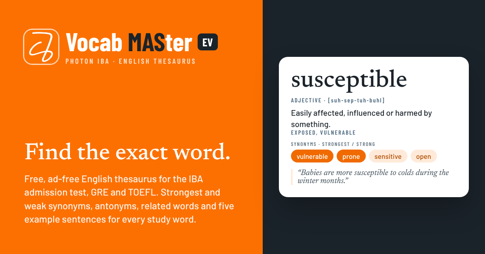

# Vocab MASter EV

**The English-only edition of Vocab MASter: a free, ad-free thesaurus and dictionary for the IBA admission test, GRE, TOEFL and everyday English.** Shared by [Photon IBA](https://github.com/photon-mas), built by MD Al Shahriar (MBA, IBA, University of Dhaka; BSc. Civil Engineering, BUET) of MAS Studio.

Live site (after you publish): https://photon-mas.github.io/vocab-master-ev/

## What's inside

- **6,488 full entries**, laid out like a Thesaurus.com word page with no ads: the word, its pronunciation (with variants and IPA, and audio from your device's voice), the part of speech and sense label, then the synonyms.
  - **Synonyms: Strongest, Strong and Weak** (orange, light orange and light green) and **Antonyms: Strongest, Strong and Weak** (red shades)
  - **47,101 example sentences, each labelled** with how the word is used: noun, past tense, past participle, gerund, adjective before a noun, and so on
  - a **word-forms table** (base, -s, past, past participle, -ing, plural, comparative, noun and adverb forms) and a sentence for each form
  - common collocations, related words, the word family, the lists that contain the word, all WordNet senses, and links to **Oxford Learner's Dictionaries** and the **Cambridge Dictionary**
- **16,168 more thesaurus entries**, so almost every synonym you tap opens a page.
- **12 study lists, IBA first**: IBA Admission (filter by test year, BBA 2005–2020 and MBA 2007–2018), GRE High Frequency, Barron's 333, GRE Complete, GRE 500 Essential, GRE 500 Advanced, GRE Hit Parade, Word Smart I, Word Smart II, TOEFL Academic Word List, Oxford 3000 Everyday and the Starter Set. **Import your own list**, for example a GregMat group.
- **Timed Test** with chess time controls: **Bullet** (10 s a question), **Blitz** (20 s), **Rapid** (30 s, the thumb rule) and **Classical** (60 s). Each has its own rating, with combos, personal bests, a review and a Mistakes deck.
- **Daily Challenge**: the same seven questions for everyone each day, with a shareable result grid and a streak.
- **Games:** Context Detective, Form Forge, spaced-repetition flashcards, a quiz, Match, Spin the Wheel, Spell It and the Word of the Day player.
- **Levels and badges:** XP for every word and answer, ten chess levels from Pawn to Grandmaster, 24 badges, and a profile with ratings, a 26-week activity heatmap and records.
- **Exam countdown:** set your test date and get a words-per-day plan.
- **Works offline** after the first visit, installs like an app, and has light and dark themes. Progress stays in your browser.

## Publish on GitHub Pages

1. **Sign in as `photon-mas`.** Open https://github.com/photon-mas and make sure you are signed in to that account (top-right avatar).
2. **Create the repository.** Click **+ → New repository**. Owner: `photon-mas`. Name: `vocab-master-ev`. Choose **Public**, leave *Add a README* unticked, and click **Create repository**.
   *Updating an existing repository instead?* Open it, click **Add file → Upload files**, and go to step 3. Files with the same name are replaced.
3. On the new, empty repository page, click the link **uploading an existing file**.
4. **Unzip** `vocab-master-ev-v1.2.0.zip`. Open the `vocab-master-ev` folder, press **Ctrl+A** (Cmd+A on Mac) to select all 92 files (plus the hidden `.nojekyll`, 93 in all), and drag them onto the upload page. Use Chrome or Edge, and drag from the freshly unzipped folder. Every file sits at the top level, so nothing gets lost in sub-folders.
5. Wait until every file shows in the list, type a commit message such as `Vocab MASter EV 1.2.0`, and click **Commit changes**.
6. **Turn on Pages.** Go to **Settings → Pages**. Under *Build and deployment*, set **Source: Deploy from a branch**, **Branch: `main`**, folder **`/ (root)`**, and click **Save**.
7. **Open the site** after 1–2 minutes: https://photon-mas.github.io/vocab-master-ev/ . The **Actions** tab shows a green tick when the deploy is done.
8. **Check it:** search *espionage* or *abate* (see the labelled sentences and the word-forms table), open **Test** and play a Rapid test, try the **Daily Challenge**, then **About**. On a phone, use **Add to Home screen** to install it.
9. *Optional:* add the site in Google Search Console and submit `sitemap.xml`, and pin the repository on your GitHub profile.

If you use a different repository name, the app still works. Only the links in `sitemap.xml`, `robots.txt` and the preview tags in `index.html` mention `vocab-master-ev`.

**Updating later:** upload the changed files the same way and commit. Each release raises the version in `sw.js`, so installed copies pick up the new version the next time they open online. The service worker only removes its own old caches, so your other apps on the same GitHub site keep theirs.

## Files

| File | What it is |
|---|---|
| `index.html` | The whole app: HTML, CSS and JavaScript in one file |
| `words-index.js` | Search index: every headword, part of speech, short definition, sense label and list tags |
| `words-01.js` … `words-60.js` | The full entries, loaded only when needed |
| `sw.js`, `manifest.webmanifest` | Offline support and app install |
| `*.woff2`, `OFL.txt` | Self-hosted fonts and their licence, so the look is the same offline |
| `author.jpg`, `author-cover.jpg` | Photos for the About page |
| `logo-mark.png`, `photon-banner.jpg`, `favicon-64.png`, `icon-*.png`, `apple-touch-icon.png`, `og-image.png` | Photon IBA logo and cover, app icons and the link-preview image |
| `verify.js` | Data check: run `node verify.js` |
| `sitemap.xml`, `robots.txt`, `.nojekyll` | Search engines and GitHub Pages settings |
| `LICENSE`, `DATA-LICENSES.md`, `CITATION.cff`, `CHANGELOG.md` | Licences, data sources, citation and release notes |

## Credits

Word lists contribute headwords only. Definitions, sense labels, synonyms, antonyms, related words, collocations, example sentences and their usage labels were written for Vocab MASter (usage labels are assigned by script and checked). Extra senses, word families and part of the weak synonyms come from WordNet 3.1 (Princeton University). Pronunciations are generated from the CMU Pronouncing Dictionary. Details are in `DATA-LICENSES.md`.

Vocab MASter EV is an independent student project. It is not an official publication of the Institute of Business Administration or the University of Dhaka.

## More from MAS Studio

- [Vocab MASter](https://al-shahriar-12.github.io/vocab-master/): the edition with Bangla meanings
- [Flexure MAS](https://al-shahriar-12.github.io/flexure-mas/): beam analysis
- [Frame MAS](https://al-shahriar-12.github.io/frame-mas/): 2D frame and truss analysis
- [BNBC Frame MAS](https://al-shahriar-12.github.io/bnbc-frame-mas/): BNBC 2020 frame design assistant
- [Beam-Frame MAS](https://al-shahriar-12.github.io/beam-frame-mas/): beams and frames in one app
- [Chess MAS](https://al-shahriar-12.github.io/chess-mas/): a break from solving problems

*If this app helped you, please remember its author in your duas.*
